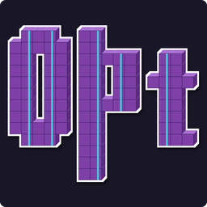

  <section class="ns-home-intro">
    
Hyperparameter optimization for .NET

    

      
      <h1>OptunaSharp</h1>
    

    

      A .NET port of <a href="https://github.com/optuna/optuna">Optuna</a> — the define-by-run
      hyperparameter optimization framework — built on top of
      <a href="https://github.com/SciSharp/NumSharp">NumSharp</a>. Optuna is the behavioral source
      of truth; OptunaSharp aligns to it.
    

    

      <a class="ns-home-button ns-home-button-primary" href="docs/intro.md">Introduction</a>
      <a class="ns-home-button" href="docs/getting-started.md">Getting started</a>
      <a class="ns-home-button" href="integrations/index.md">Integrations</a>
      <a class="ns-home-button" href="api/index.md">API reference</a>
    

  </section>

  <section class="ns-home-code" aria-label="Status">
    

      <h2>Status: core surface ported</h2>
      
The core algorithm surface is in place — samplers, pruners, storages, importance, and visualization — with more landing module-by-module.

    

    

      <pre><code class="lang-bash">dotnet add package OptunaSharp</code></pre>
      <pre><code class="lang-python"># The Optuna API OptunaSharp targets (Python)
import optuna
def objective(trial):
    x = trial.suggest_float("x", -10, 10)
    return (x - 2) ** 2
study = optuna.create_study()
study.optimize(objective, n_trials=100)</code></pre>
    

  </section>

  <section class="ns-home-section">
    

      <h2>Documentation Map</h2>
      
Pick where you want to start.

    

    

      <a class="ns-doc-card" href="docs/intro.md">
        Overview
        <strong>Introduction</strong>
        
What OptunaSharp is, the study/trial model, and how it relates to Optuna and NumSharp.

      </a>
      <a class="ns-doc-card" href="docs/getting-started.md">
        Setup
        <strong>Getting started</strong>
        
Install, build, test, and pack. How the NumSharp reference resolves.

      </a>
      <a class="ns-doc-card" href="api/index.md">
        Reference
        <strong>API reference</strong>
        
Generated from the OptunaSharp assemblies by DocFX.

      </a>
    

  </section>

  <section class="ns-home-links" aria-label="Community links">
    <a href="integrations/index.md">Explore all integrations</a>
    <a href="https://github.com/SciSharp/OptunaSharp">GitHub Repository</a>
    <a href="https://www.nuget.org/packages/OptunaSharp">NuGet Package</a>
    <a href="https://github.com/SciSharp/NumSharp">NumSharp</a>
  </section>

